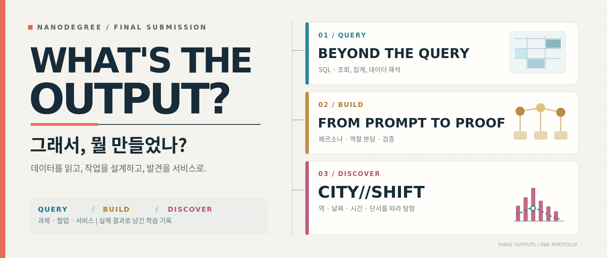
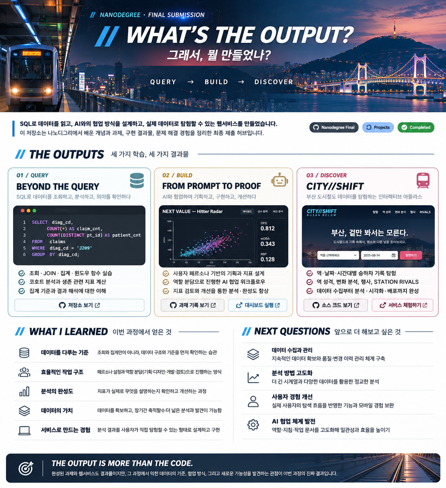
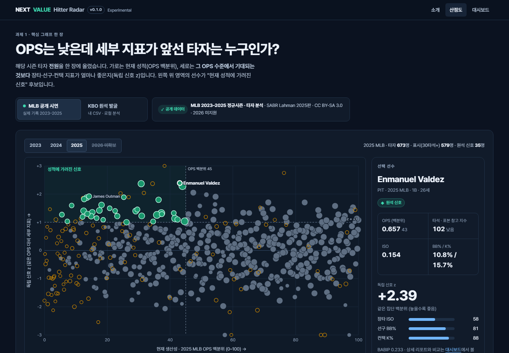
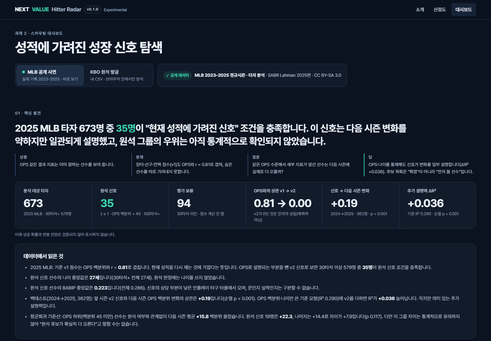
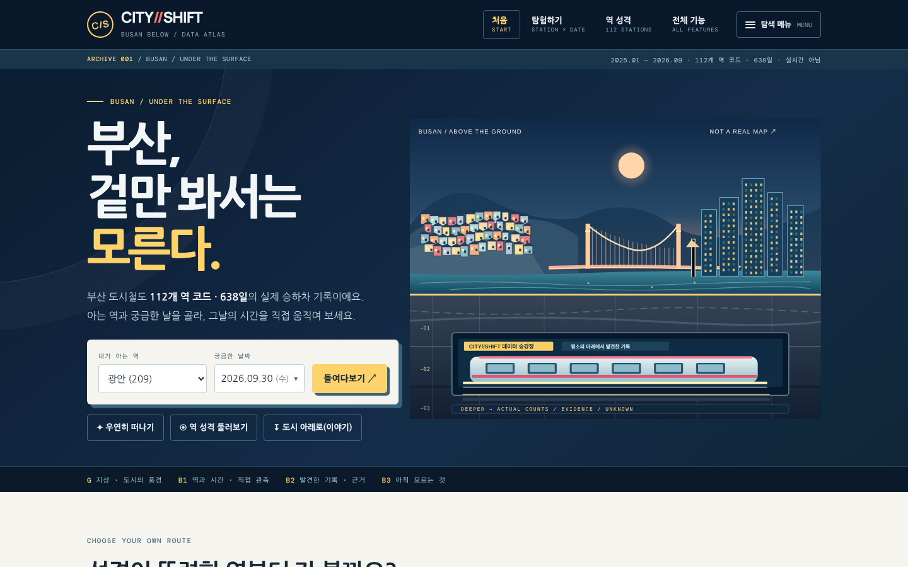
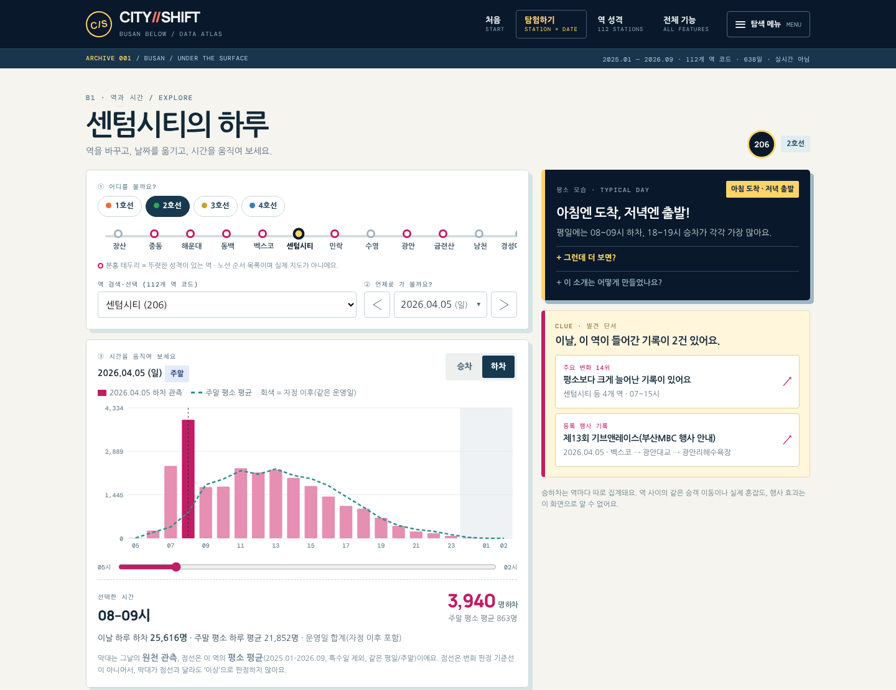
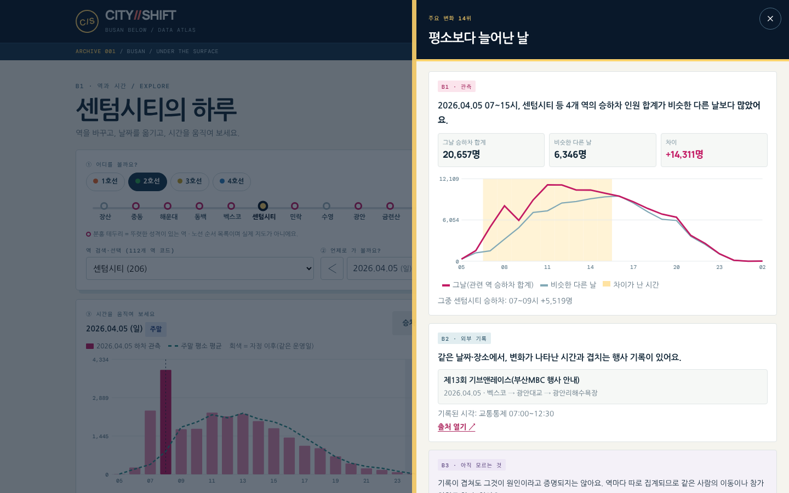
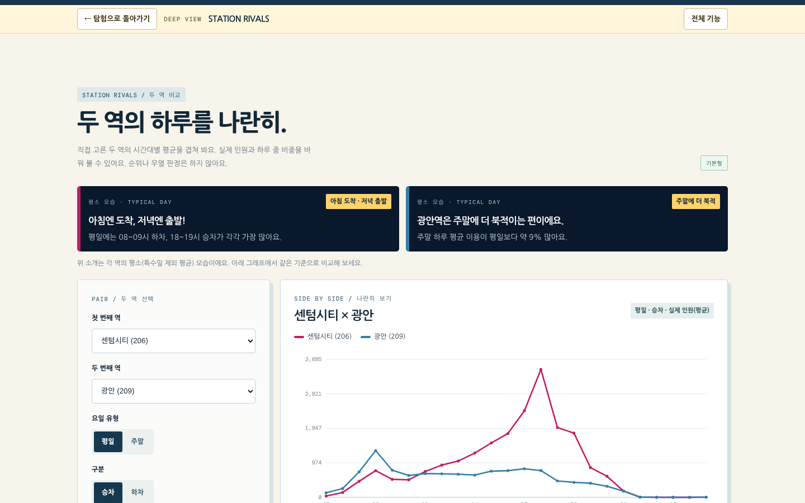

**SQL로 데이터를 읽고 · AI 협업을 설계하고 · 실제 데이터로 탐험할 수 있는 서비스를 만들다**

[**SQL 결과물**](https://github.com/Justman-yzz/nanodegree-sql) · [**AI Agent 결과물**](https://github.com/Justman-yzz/nanodegree-ai-agent) · [**최종 프로젝트**](https://github.com/Justman-yzz/city-shift) · [**CITY//SHIFT 실행**](https://justman-yzz.github.io/city-shift/)

---

이 저장소는 SQL·AI Agent 나노디그리에서 **무엇을 배웠고, 직접 무엇을 해봤으며, 어떤 문제를 해결했는지**를 실제 결과물 중심으로 모은 최종 제출 허브입니다.

## 01 / THE OUTPUTS

|  | 결과물 | 무엇을 남겼나 | 바로 보기 |
|:--|:--|:--|:--|
| **QUERY** | **BEYOND THE QUERY** | SQL 조회·집계·윈도우 함수·코호트 분석과 과제 기록 | [SQL 저장소](https://github.com/Justman-yzz/nanodegree-sql) |
| **BUILD** | **FROM PROMPT TO PROOF** | 페르소나 기반 기획, AI 협업, 시각화·대시보드 구현과 검증 | [AI Agent 저장소](https://github.com/Justman-yzz/nanodegree-ai-agent) |
| **DISCOVER** | **CITY//SHIFT** | 부산 도시철도 기록을 직접 탐험하는 서비스의 분석·구현·배포 | [서비스 실행](https://justman-yzz.github.io/city-shift/) · [소스](https://github.com/Justman-yzz/city-shift) |

> 세 과정의 데이터와 소스는 각각 구분해 관리합니다. AI Agent 과제의 실행 결과물인 **[NEXT VALUE — Hitter Radar](https://github.com/Justman-yzz/next-value-hitter-radar)** 역시 별도 저장소에서 확인할 수 있습니다.

세 가지 결과물과 학습 성과를 정리한 비주얼 요약 · 실제 실행 화면은 각 프로젝트 섹션에서 확인할 수 있습니다.

## 02 / QUERY — BEYOND THE QUERY

### 결과를 구하기 전에, 무엇을 세는지부터

`SELECT`·`JOIN`·`GROUP BY`·윈도우 함수·CTE 등을 활용해 교육용 의료 데이터의 조회, 명세서·상병 집계, 환자별 방문 간격과 코호트 분석을 수행했습니다.

| 대표 실습 | 확인한 결과 |
|:--|--:|
| 조건에 맞는 외래 명세서 집계 | **1,450건** |
| J209 명세서 / 고유 수진자 구분 | **2,554건 / 894명** |
| 최초 진단 기간으로 구성한 폐암 코호트 | **6,873명** |

가장 크게 배운 것은 **SQL이 정상 실행되는 것과 질문에 맞는 결과를 얻는 것은 다르다**는 점입니다. JOIN으로 행이 중복되거나 사라지지 않는지, 집계 단위와 분모가 무엇인지 확인하는 습관을 익혔습니다.

**[SQL 학습·과제·문제 해결 기록 보기](https://github.com/Justman-yzz/nanodegree-sql)** · [병기별 결과 시각화](https://github.com/Justman-yzz/nanodegree-sql/blob/main/assets/stage-outcomes.svg)

## 03 / BUILD — FROM PROMPT TO PROOF

### 페르소나를 정하고, 협업 방식을 설계하다

AI Agent 학습에서는 **누가 무엇을 판단하려는가**라는 사용자 페르소나에서 출발해 필요한 질문·지표·차트를 정하고, Claude Code와 함께 그래프와 대시보드를 구현했습니다.

과제 결과인 **NEXT VALUE — Hitter Radar**는 MLB 2023~2025 정규시즌 타자 데이터를 탐색하는 산점도와 대시보드입니다. 시즌·선수 필터, KPI, 비교와 탐색적 백테스트 등을 구현했습니다.

**[산점도 실행 ↗](https://justman-yzz.github.io/next-value-hitter-radar/graph.html)** · **[대시보드 실행 ↗](https://justman-yzz.github.io/next-value-hitter-radar/dashboard.html)** · [구현 코드](https://github.com/Justman-yzz/next-value-hitter-radar)

  
  

?ㅼ젣 ?ㅽ뻾 ?붾㈃ ??怨듦컻??NEXT VALUE ?곗젏?꾩? ?€?쒕낫??/sub>

### 협업도 하나의 설계 대상이었다

학습한 방식을 이후 프로젝트에 적용하며 **기획·디자인·개발·리뷰·기술문서** 역할을 나눴습니다. 역할마다 판단할 문제, 넘겨줄 자료, 검증할 기준을 분리하니 작업의 흐름을 더 명확히 관리할 수 있었습니다.

프로젝트 공통 지침과 작업별 프롬프트·Skills의 용도도 구분했습니다. 반복 설명을 줄이고 긴 작업에서도 방향을 유지하기 위한 **컨텍스트 관리 방식**을 직접 다듬었습니다.

또한 NEXT VALUE에서는 초기 지표가 기존 OPS와 너무 비슷한 신호를 내는 문제를 확인해 잔차 기반 지표로 수정했습니다. **구현한 기능이 실제로 무엇을 설명하는지 점검하고 개선하는 과정**까지 경험했습니다.

**[AI Agent 학습·과제·재현 프롬프트 보기](https://github.com/Justman-yzz/nanodegree-ai-agent)**

## 04 / DISCOVER — CITY//SHIFT

### 부산, 겉만 봐서는 모른다.

부산 도시철도의 실제 승하차 기록을 **역·날짜·시간대별로 직접 탐험하는 데이터 아틀라스**입니다. 단순한 숫자 조회를 넘어 역의 평소 모습, 변화가 나타난 날, 관련 외부 기록까지 이어집니다.

실제 서비스 화면 ① — 부산 도시 단면 일러스트에서 역과 날짜를 고르기

 

실제 서비스 화면 ② — 시간대별 관측값과 평소 평균을 움직여 비교하기

### 숫자에서 실제 탐험으로

| 데이터와 검증 | 사용자가 경험하는 기능 |
|:--|:--|
| **112개 역 코드 · 638일** | 역·날짜·시간 선택 |
| **3,429,888개 원천 관측값** | 시간대별 승차·하차 그래프 |
| **변화 기록 · 행사 분석 18건** | 발견 단서·외부 기록 확인 |
| **역별 평소 패턴** | 역 성격 · **STATION RIVALS** |
| **공개 검사 122/122 통과** | GitHub Pages 공개 서비스 |

<b>실제 화면 더 보기 — 발견 단서와 두 역 비교</b>

### 가장 크게 느낀 것 — 데이터의 확보와 축적

CITY//SHIFT를 진행하면서 **데이터를 확보하는 일 자체가 분석만큼 중요하다**는 것을 체감했습니다. 필요한 자료를 찾는 것뿐 아니라 수집 방법, 가공·보관·공개 조건까지 확인해야 했습니다. 공개된 자료라고 해서 마음대로 재배포하거나 결합할 수 있는 것도 아니었습니다.

또한 데이터가 충분한 기간 동안 일관되게 축적되어야 **평소와 다른 순간을 비교하고, 새로운 질문을 발견할 기회**가 생긴다는 점이 인상 깊었습니다. 앞으로도 수집 가능한 데이터를 장기적으로 관리하고, 여러 관점을 연결해 새로운 서비스를 만드는 방향에 관심을 갖게 됐습니다.

### 사용자가 직접 발견하도록 바꾼 경험

초기 화면은 분석 결과와 설명을 너무 많이 담아 핵심이 잘 드러나지 않았습니다. 이후 **정해진 결과를 설명하는 흐름**에서 **사용자가 역과 날짜를 고르고 발견한 단서를 따라가는 흐름**으로 중심을 바꿨습니다.

이 과정에서 좋은 분석 결과도 사용자가 이해하고 직접 탐색할 수 있게 설계해야 가치가 전달된다는 점을 배웠습니다. 또한 관측값, 관련 외부 기록, 아직 알 수 없는 사실을 구분해 **발견과 원인 추정이 섞이지 않도록** 했습니다.

**[CITY//SHIFT 직접 탐험하기 ↗](https://justman-yzz.github.io/city-shift/)** · **[코드·데이터·기술문서 보기](https://github.com/Justman-yzz/city-shift)**

## 05 / WHAT I LEARNED

| 이번에 익힌 관점 | 직접 적용한 내용 |
|:--|:--|
| **데이터를 읽는 기준** | 조회 조건·JOIN·집계 단위·분모 검산 |
| **사용자 중심 기획** | 페르소나 → 질문 → KPI → 시각화 |
| **효율적인 협업 구조** | 기획·디자인·개발·리뷰 역할 분리, 지침·작업 기록 관리 |
| **데이터를 다루는 책임** | 수집 경로·공개 범위·활용 조건 점검 |
| **분석을 서비스로 만드는 방법** | 관측·근거·한계 구분, 탐험형 UX, 배포·회귀 검사 |

기존의 GitHub 개발·협업 경험 위에, 이번에는 **데이터 확보부터 분석, 구현, 검증, 공개까지 연결하는 경험**을 더했습니다.

## 06 / NEXT QUESTIONS

- **데이터 수집·품질 관리:** 허용된 경로로 지속 수집하고 출처·시점·변경 이력을 체계적으로 관리하기
- **분석 고도화:** 더 긴 시계열과 독립적인 자료로 비교 기준과 이상탐지를 검증하기
- **사용자 경험:** 실제 사용자의 탐험 흐름과 모바일 이용성을 관찰하며 개선하기
- **협업 체계:** 역할별 작업 문서와 재사용 가능한 검증 절차를 더 정교하게 만들기

## 07 / PROJECT INDEX

| 저장소 | 확인할 내용 |
|:--|:--|
| [nanodegree-sql](https://github.com/Justman-yzz/nanodegree-sql) | SQL 학습·실습·과제 |
| [nanodegree-ai-agent](https://github.com/Justman-yzz/nanodegree-ai-agent) | AI Agent 과제·프롬프트·협업 기록 |
| [next-value-hitter-radar](https://github.com/Justman-yzz/next-value-hitter-radar) | MLB 타자 데이터 시각화·대시보드 |
| [city-shift](https://github.com/Justman-yzz/city-shift) | 부산 도시철도 데이터 탐험 서비스 |

---

**THE OUTPUT IS MORE THAN THE CODE.**

과제와 서비스, 데이터의 기준, 협업 방식, 그리고 다음 발견을 위한 질문까지.

